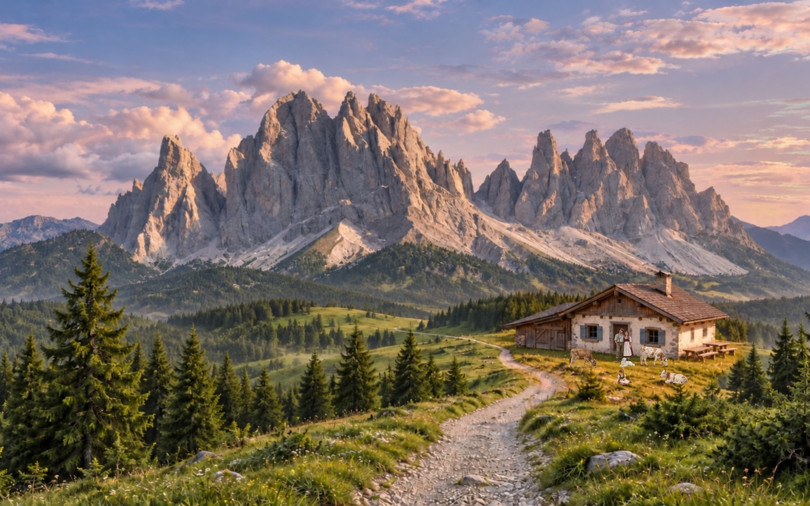

# Odle Dolomites Italy

A macOS screen saver showing the photographic Odle scene: the Val di Funes landscape with the sky computed for the real time, the seasons, the mountain hut and its inhabitants. It keeps only the landscape: panels, controls, tooltips and interactive points are turned off.



## Requirements

* macOS 12 or later (tested on macOS 15.7, Intel Mac with two displays).
* Xcode or the Command Line Tools, for `swiftc`.

## Build and install

The ready screen saver is attached to the [GitHub releases](https://github.com/alirux/odle-live-panorama/releases/latest), with the steps to install it in [screensaver/release/README.md](../../screensaver/release/README.md): nothing has to be built for that.

From the repository root:

```bash
screensaver/build.sh            # creates screensaver/build/Odle Dolomites Italy.saver
screensaver/build.sh --install  # also copies it into ~/Library/Screen Savers
screensaver/build.sh --release  # also zips it into screensaver/release/ for a GitHub release
```

Then pick it in System Settings → Screen Saver, under "Other".

The screen saver bundle contains its own copy of the scene, taken from `core/` and `screensaver/web/`. After changing them, rebuild it with `screensaver/build.sh --install`.

To uninstall it, delete `~/Library/Screen Savers/Odle Dolomites Italy.saver` and choose another screen saver.

## Options

In System Settings → Screen Saver → Options:

- **Time**: real time, accelerated or a fixed time of day (local time of the chosen place). Accelerated starts from the current time and runs the clock faster: a whole day lasts 1 minute (the default), 3, 7, 15 or 30 minutes, so the sun, the moon, the stars and the light change visibly but slowly. Snow flurries, the rescue helicopter and the paraglider are paused while time is accelerated.
- **Season**: automatic, winter or summer (the scene has no other seasons). The scene starts from mid January or mid July, at the current time of day (real or accelerated time); the seasons are reversed in the southern hemisphere.
- **Place**: the list of known locations (Val di Funes, Milan, Amsterdam, ..., Zagreb). It changes the sky, sun, stars and time zone; the landscape stays the Odle.
- **Frame rate**: 15, 24 or 30 fps.
- **Show Anna**: turn it off to remove the girl from the scene.
- **Animate only the main display**: the other displays stop on the first frame once the scene is ready (the preview always moves).
- **Reduce to 15 fps on battery**: on battery power the frame rate drops to 15.

## Known limitations

* The scene is drawn at density 1 even on Retina displays, so it is slightly less sharp than a full resolution rendering. Drawing it at full density would cost about four times as much, because WebKit1 draws the canvas on the CPU.
* It uses deprecated APIs (WebKit1) and private WebKit methods: a macOS update may break it.
* It is signed only locally and is not notarized by Apple. Other Macs may require the manual authorization described in [screensaver/release/README.md](../../screensaver/release/README.md#2-if-macos-blocks-it). Developer ID signing and notarization would make distribution easier.
* The gallery thumbnail is static.

## Documentation

The [development notes](development.md) explain how the screen saver works, the choices behind it (almost all made to avoid black screens or a CPU at 100%), the measured CPU usage and how to test it without locking the Mac.

## Licence

The screen saver code is licensed under the [Apache License 2.0](../../LICENSE). The landscape and derived images are under CC BY-SA 3.0, from the photograph [“Gruppo delle Odle dalla malga Geisleralm” by Luca Lorenzi](https://commons.wikimedia.org/wiki/File:Gruppo_delle_Odle_dalla_malga_Geisleralm.jpg). The bundle includes `LICENSE`, `LICENSE-CONTENT.txt` and `NOTICE` in `Contents/Resources/`; see [NOTICE](../../NOTICE) for the attribution.
